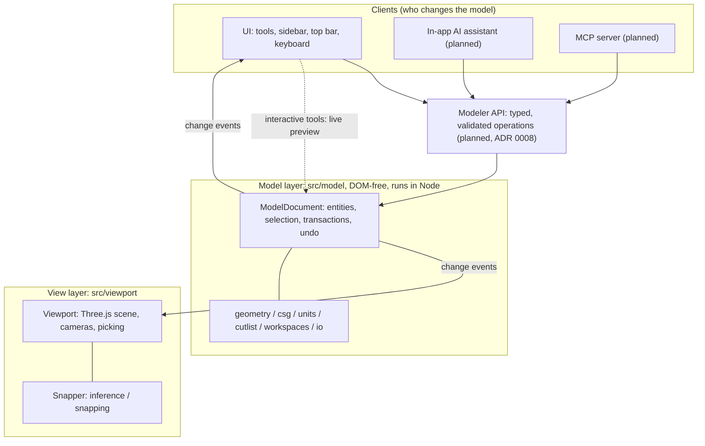

# Architecture

Vite + TypeScript + Three.js, no UI framework ([ADR 0003](adr/0003-vanilla-typescript-threejs.md)). CSG (boolean operations) is done by `three-bvh-csg`. About 6k lines of TypeScript.

## Layers



**Rule of thumb:** the model layer knows nothing about the screen. The view layer renders the model and answers "what's under the cursor?". Clients change the model only through the API ([ADR 0008](adr/0008-modeler-api-single-entry-point.md)).

### Current state vs target

The Modeler API layer is **designed but not yet extracted** ([modeler-api.md](modeler-api.md)). Today the clients reach the document directly:

| Who | How it changes the model today | Target |
|---|---|---|
| Interactive tools (`src/tools`) | mutate the entity inside `doc.begin()` … `doc.commit()`, calling `doc.touch()` for live preview | unchanged for the live drag; the final state must pass the same validation as the API |
| Sidebar (`src/ui/Sidebar.ts`) | `doc.transact(() => doc.update(...))` | call API operations (`update_entity`, `set_hole`, …) |
| Commands (`App.runCommand`) | mix of document edits and UI actions | document edits → API; UI-only actions (dialogs, toasts, camera) stay in `App` |

Extracting this layer is the first step of the AI work ([roadmap](roadmap.md)).

## Key concepts

### Entities ([ADR 0001](adr/0001-parametric-entities-mm-z-up.md))

`src/model/types.ts`. Every part is one of:

| kind | parameters | local frame |
|---|---|---|
| `box` | `size: [x, y, z]` | spans `[0, size]` from the origin |
| `cylinder` | `radius`, `height`, `segments` | base centre at the origin, extends +Z |
| `extrusion` | `points: [x, y][]`, `height` | closed outline on local XY, extruded +Z |

All kinds share `id`, `name`, `position` (world mm), `rotation` (Euler XYZ, degrees), `color`, `hole`, `visible`. World units: **mm, Z-up** (X red, Y green, Z blue).

### Document and transactions ([ADR 0002](adr/0002-document-transactions-snapshot-undo.md))

`ModelDocument` (`src/model/Document.ts`) owns `entities`, `selection`, `units` and document settings (`workspace`, `printer`).

- `begin()` → mutations → `commit()` records **one undo step** (a JSON snapshot); `cancel()` rolls back. `transact(fn)` wraps a function, joining an open transaction if there is one.
- Every mutation emits `onChange({committed})`. `committed: false` during a drag, so the viewport updates live; `true` on commit, which triggers autosave.
- `version` increments on every change. It's the cache key for derived data (snap points, volumes).
- Undo history holds up to 200 steps. `workspace`, `printer` and `units` are document settings, **not** part of undo.

### Rendering

`Viewport.sync()` rebuilds a mesh only when its entity changed. The cache key is the entity JSON plus the JSON of every hole overlapping it, so moving a hole re-cuts only the solids it touches. Per entity:

- **Mesh:** `buildCutGeometry` in `csg.ts` makes the geometry, with holes subtracted ([ADR 0005](adr/0005-holes-as-csg-cutters.md)).
- **Edges:** `featureEdges` in `edges.ts` draws creases above 25° plus open boundaries, and drops seams that CSG leaves inside flat faces.
- **Styling:** `updateStyles()` applies selection, hover, print-warning, hole and x-ray looks.

Rendering is on demand (`requestRender()`), not a constant loop.

Scene helpers:
- `Grid.ts`: an infinite shader grid whose spacing adapts to the zoom (1 mm → 1 m) and fades between levels.
- `SceneHelpers.ts`: the print bed and build volume, and the scale figure.
- `overlay.ts`: temporary lines and labels for tools.

### Interaction

- **Tools** ([ADR 0004](adr/0004-tools-edit-live-entities.md)): `src/tools/*`. Each tool is a small state machine (`idle → rect → height`, …). It receives pointer events, key presses and typed values from the measurement box. Drawing tools add a real entity at the first click and update it live, so the preview *is* the result.
- **Snapper:** `src/viewport/Snapper.ts` turns a cursor position into a 3D point. Priority: snap points within 14 px (corners > centres > midpoints), then faces, then the ground; free positions are rounded to the snap step.
- **Commands and keymap** ([ADR 0006](adr/0006-command-registry-and-keymap.md)): `commands.ts` lists every bindable action and `keymap.ts` maps keys to command ids. User overrides live in `localStorage`. `App.runCommand(id)` executes them, and the toolbar buttons go through the same function.
- **Hold-to-navigate:** holding the pan/orbit key gives the left mouse button to `OrbitControls` without switching tools, so an operation in progress survives. A quick tap of the same key is forwarded to the tool as a key press.

### Workspaces ([ADR 0007](adr/0007-workspaces-are-configuration.md))

`src/model/workspaces.ts` holds three configuration objects: units, snap step, grid base, home view, swatches, cylinder segments, sidebar panels, print plate on/off, scale figure on/off. It also holds the printer profiles and the pure functions `checkPrintFit`, `placeOnPlateDelta` and `meshVolume`. `App.applyWorkspace` pushes the configuration into the viewport, sidebar and settings.

## Persistence

| What | Where | Key / format |
|---|---|---|
| Model (autosave) | `localStorage` | `modeler.autosave.v1`, a `DocumentFile` |
| Project file | download / open / drag-drop | `*.modeler.json`: `{format: 'modeler', version: 1, units, workspace, printer, entities}` |
| App settings (snap per workspace, cut preview, filament) | `localStorage` | `modeler.settings.v1` |
| Shortcut overrides, hold keys | `localStorage` | `modeler.keymap.v1` |
| Last sidebar tab | `localStorage` | `modeler.sidebarTab` |

Loading is defensive (`parseDocumentFile`): invalid entities are dropped, duplicate ids re-issued, and unknown workspaces or printers fall back to defaults.

## Invariants

These must hold after every committed change. The Modeler API will enforce them in one place.

1. All lengths are finite and in mm; sizes, radius and height are > 0; extrusion outlines have ≥ 3 points and non-zero area.
2. Entity ids are unique strings; names are non-empty.
3. Stored numbers are clean (`cleanNumber` / `cleanVec`): no `599.9999999` in the properties panel or cut list.
4. One user action, or one AI turn, is **one undo step**.
5. The model layer (`src/model`) never imports from `viewport`, `ui`, `tools` or the DOM.

## Module map

```
src/
  main.ts             entry; creates App, exposes window.modeler (debug + smoke test)
  App.ts              layout, toolbar, workspace switching, keyboard/pointer routing, runCommand
  commands.ts         bindable command list + default keys
  keymap.ts           combo parsing/display, conflicts, persistence (pure, unit-tested)
  model/              DOM-free domain layer (unit-tested)
    types.ts            Entity, DocumentFile, Unit
    Document.ts         ModelDocument: entities, selection, transactions, undo, events
    geometry.ts         meshes from entities, bounds, snap points, faces, push/pull, drawing planes
    csg.ts              hole subtraction (three-bvh-csg), world geometry for export
    units.ts            parse/format lengths and angles
    cutlist.ts          cut list grouping + CSV
    io.ts               file parse/validate, STL export, autosave, settings
    workspaces.ts       workspace configs, printers, fit check, volume
  viewport/           Three.js rendering + picking
    Viewport.ts         scene, cameras, zoom, entity→mesh sync, styles, picking, highlights
    Snapper.ts          inference engine
    Grid.ts, SceneHelpers.ts, edges.ts, overlay.ts
  tools/              interactive tools (Tool base + one class per tool)
  ui/                 Sidebar (Properties/Print/Quantities/Cut list/Objects), ShortcutsDialog, icons, dom helper
tests/                vitest unit tests for model + keymap + edges
scripts/smoke.mjs     end-to-end test driving the real UI in headless Chrome
```
